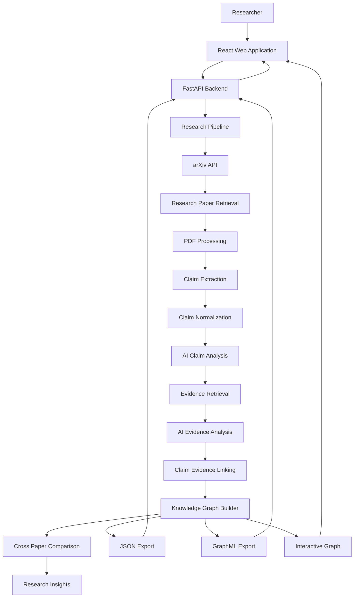
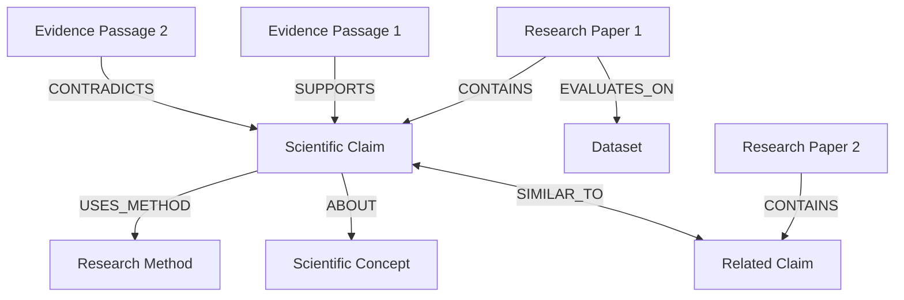
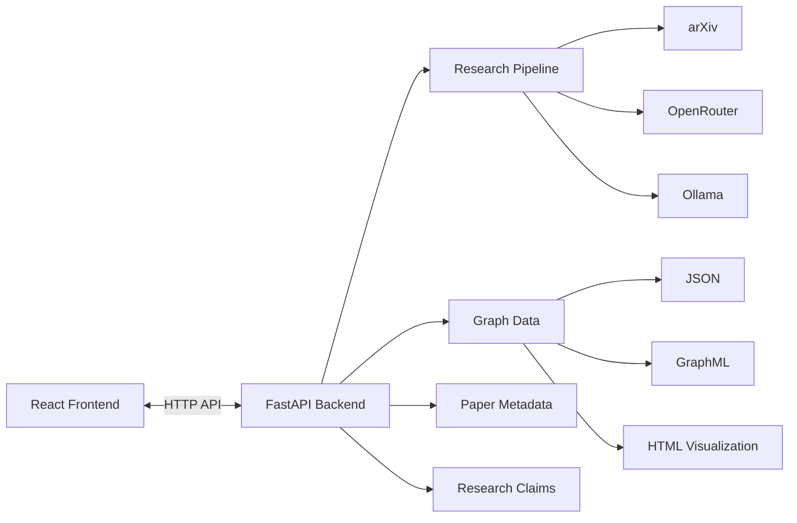
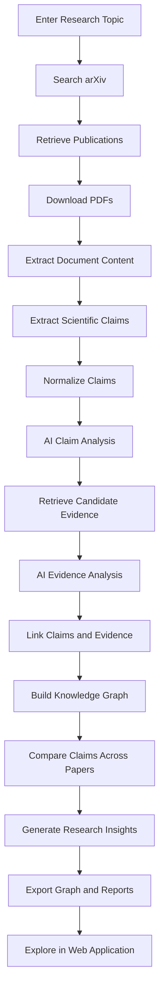

# Alethia

### AI-Powered Scientific Literature Intelligence & Knowledge Graph Platform

<p align="center">
  <strong>Transforming scientific literature into connected, traceable, and explorable knowledge.</strong>
</p>

<p align="center">
  
  
  
  
  
  
</p>

---

## 1. Introduction

**Alethia** is an AI-powered scientific literature intelligence platform designed to transform unstructured research papers into structured, interconnected scientific knowledge.

Scientific knowledge is distributed across thousands of research publications. Understanding how different studies relate to one another requires researchers to manually read papers, identify findings, compare methodologies, evaluate evidence, and investigate potentially conflicting conclusions.

Alethia aims to automate and organize this process.

It combines:

- Natural Language Processing (NLP)
- Large Language Models (LLMs)
- Scientific information retrieval
- Automated claim extraction
- Evidence retrieval and analysis
- Cross-paper claim comparison
- Knowledge graph construction
- Interactive graph visualization
- Research intelligence and insights

Rather than treating research papers as isolated documents, Alethia connects their claims, evidence, methodologies, algorithms, models, datasets, and scientific concepts into a unified knowledge representation.

### Our Vision

> Scientific knowledge should not remain trapped inside individual research papers. It should be connected, traceable, and explorable.

---

## 2. The Problem

Scientific research is growing exponentially.

Every year, researchers publish thousands of papers containing new findings, methodologies, algorithms, hypotheses, and experimental results.

However, scientific knowledge remains fragmented across individual publications.

Researchers frequently encounter several problems:

- Finding relevant research across multiple publications.
- Identifying claims made by different researchers.
- Determining which evidence supports a particular claim.
- Discovering potentially contradictory findings.
- Comparing methodologies across research papers.
- Understanding relationships between scientific concepts.
- Identifying repeated research patterns.
- Tracking the development of scientific ideas.

Traditional research workflows provide access to publications but do not inherently provide a connected representation of the knowledge contained within them.

### Alethia's Approach

Alethia transforms scientific publications into structured knowledge.

It extracts claims, identifies potentially relevant evidence, analyzes relationships, and connects the resulting information through a scientific knowledge graph.

This creates a foundation for more intelligent scientific literature exploration.

---

## 3. What Alethia Does

Alethia implements a multi-stage scientific literature intelligence pipeline.

| Component | Responsibility |
|---|---|
| Paper Retrieval | Retrieves scientific publications from arXiv |
| PDF Processing | Extracts structured content from research papers |
| Claim Extraction | Identifies potentially meaningful scientific claims |
| Claim Normalization | Structures claims into standardized representations |
| SVO Extraction | Identifies subjects, verbs, and objects |
| AI Claim Analysis | Classifies and analyzes scientific claims |
| Evidence Retrieval | Finds potentially relevant passages |
| Evidence Analysis | Evaluates claim-evidence relationships |
| Evidence Linking | Connects analyzed evidence to scientific claims |
| Knowledge Graph Construction | Builds interconnected scientific entities |
| Cross-Paper Comparison | Identifies potentially related claims |
| Research Insights | Generates structured observations |
| Visualization | Provides interactive knowledge graph exploration |
| Web Application | Provides a unified research workspace |

---

## 4. System Architecture

Alethia follows a modular architecture consisting of a frontend, backend API, AI processing pipeline, and knowledge graph layer.

### High-Level Architecture



### Architectural Layers

**1. Presentation Layer**

The React and TypeScript frontend provides the research workspace, investigation interface, graph exploration, paper library, and research insights.

**2. API Layer**

FastAPI manages communication between the frontend and backend processing components.

**3. Processing Layer**

Python-based modules perform paper retrieval, PDF extraction, claim identification, evidence retrieval, and AI-assisted analysis.

**4. Intelligence Layer**

LLMs analyze scientific claims and evaluate the semantic relationships between claims and evidence.

**5. Knowledge Layer**

NetworkX constructs a provenance-preserving scientific knowledge graph.

**6. Visualization Layer**

Interactive visualizations allow researchers to explore entities and their relationships.

---

## 5. Core Components

### 5.1 Scientific Paper Retrieval

**File:** `backend/app/search/arxiv/download.py`

Alethia retrieves scientific publications through the arXiv API.

The retrieval process:

1. Accepts a research topic.
2. Constructs an arXiv search query.
3. Retrieves relevant publication metadata.
4. Identifies available PDF links.
5. Downloads research publications.
6. Stores paper metadata for subsequent processing.

The system uses arXiv as its initial scientific publication source.

### 5.2 PDF Processing

**File:** `backend/app/extraction/extractor.py`

Research papers are processed using PyMuPDF4LLM.

The extraction component:

- Converts PDF documents into Markdown-like text.
- Extracts document content.
- Identifies section headings.
- Preserves document structure where possible.
- Prepares extracted content for downstream NLP processing.

### 5.3 Scientific Claim Extraction

**File:** `backend/app/extraction/claim_extractor.py`

The claim extraction component identifies potentially meaningful scientific statements.

These include:

- Research findings.
- Experimental results.
- Scientific conclusions.
- Hypotheses.
- Methodological claims.
- Comparative statements.
- Theoretical propositions.

The objective is to separate meaningful scientific assertions from surrounding document content.

### 5.4 Claim Normalization and SVO Extraction

**File:** `backend/app/extraction/claim_normalizer.py`

Scientific claims often express similar ideas using different terminology and sentence structures.

Alethia uses spaCy and the `en_core_web_lg` language model to process and normalize extracted claims.

An important component is Subject-Verb-Object (SVO) extraction.

For example:

```text
Original Claim:

The proposed model improves classification accuracy
on medical imaging datasets.

Subject:
The proposed model

Relation:
Improves

Object:
Classification accuracy
```

The normalized representation helps downstream components identify relationships between scientific statements.

The component also implements verb-strength calculations based on linguistic patterns.

### 5.5 AI-Assisted Claim Analysis

**File:** `backend/app/extraction/ai_claim_analyzer.py`

Alethia uses Large Language Models through OpenRouter to analyze extracted scientific claims.

The AI analysis component produces structured information, including:

- Normalized scientific claim.
- Subject.
- Relation.
- Object.
- Claim type.
- Evidence requirement.
- Confidence score.

Supported claim categories include:

| Category | Description |
|---|---|
| Method | Describes a research methodology |
| Result | Reports an experimental result |
| Comparison | Compares different approaches |
| Finding | Reports a scientific finding |
| Hypothesis | Presents a scientific hypothesis |
| Theoretical | Describes theoretical propositions |
| Dataset | Discusses datasets |
| Limitation | Identifies research limitations |
| Conclusion | Presents research conclusions |
| Other | Other scientific statements |

The resulting structured representation is used by subsequent pipeline stages.

### 5.6 Evidence Retrieval

**File:** `backend/app/extraction/evidence_retriever.py`

After identifying scientific claims, Alethia searches for potentially relevant evidence within the extracted research documents.

The retrieval component uses:

- NLTK sentence tokenization.
- TF-IDF vectorization.
- Cosine similarity.

The process:

1. Splits research documents into sentences.
2. Converts claims and candidate sentences into TF-IDF representations.
3. Calculates cosine similarity.
4. Filters exact and near-identical matches.
5. Ranks candidate passages.
6. Returns the highest-ranked evidence candidates.

The system supports configurable top-k evidence selection.

**Important:** Similarity identifies potentially relevant passages. It does not establish whether a passage actually supports a scientific claim.

### 5.7 AI-Assisted Evidence Analysis

**File:** `backend/app/extraction/ai_evidence_analyzer.py`

This component evaluates retrieved evidence against its corresponding scientific claim.

Alethia uses Ollama for local LLM inference, with `llama3.2` as the default configured model.

Each candidate passage is evaluated independently.

The system classifies evidence relationships into four categories:

| Relationship | Meaning |
|---|---|
| `supports` | Passage provides information supporting the claim |
| `contradicts` | Passage provides information conflicting with the claim |
| `insufficient` | Passage does not provide enough information |
| `irrelevant` | Passage is not useful for evaluating the claim |

Each analyzed passage receives:

- Original evidence sentence.
- Similarity score.
- Relationship classification.
- Evidence strength.
- Explanation of the classification.

Evidence strength is represented on a scale from 0.0 to 1.0.

The component also determines:

- Best evidence.
- Overall claim-evidence relationship.
- Overall evidence strength.

Analysis results are returned as structured JSON and validated before storage.

**Scientific consideration:** Evidence strength describes the strength of the relationship between a passage and a claim. It does not establish that the scientific claim is objectively true.

### 5.8 Claim-Evidence Linking

**File:** `backend/app/extraction/claim_evidence_linker.py`

The linking component filters analyzed evidence before connecting it to scientific claims.

The current implementation retains passages satisfying these conditions:

- Similarity score of at least `0.1`.
- Relationship classified as `supports`.
- Evidence strength of at least `0.3`.

The final evidence representation preserves:

- Original evidence.
- Similarity.
- Relationship.
- Evidence strength.
- AI reasoning.

### 5.9 Knowledge Graph Construction

**File:** `backend/app/extraction/knowledge_graph_builder.py`

The knowledge graph builder is one of Alethia's central components.

It transforms extracted scientific information into a provenance-preserving directed multigraph using NetworkX.

Instead of representing each paper as an isolated document, Alethia creates interconnected graph entities.

#### Graph Node Construction

The current implementation supports:

- Research papers.
- Scientific claims.
- Evidence passages.
- Research methodologies.
- Algorithms.
- Machine learning models.
- Datasets.
- Scientific concepts.
- Extracted subjects and objects.
- Hypotheses.

#### Graph Relationships

The graph uses typed, directed relationships.

Examples include:

| Relationship | Purpose |
|---|---|
| `CONTAINS` | Connects a paper to its claims |
| `SUPPORTS` | Represents supporting evidence |
| `CONTRADICTS` | Represents contradictory evidence |
| `INSUFFICIENT` | Represents insufficient evidence |
| `IRRELEVANT` | Represents irrelevant evidence |
| `ABOUT` | Connects claims to concepts |
| `DISCUSSES` | Represents discussion relationships |
| `USES_METHOD` | Connects research to methodologies |
| `USES_ALGORITHM` | Connects research to algorithms |
| `EVALUATES_ON` | Connects research to datasets |
| `INTRODUCES` | Represents introduced contributions |
| `EXPRESSES_HYPOTHESIS` | Connects claims to hypotheses |
| `SIMILAR_TO` | Connects potentially related claims |

#### Deterministic Entity Identification

Alethia generates stable entity identifiers using SHA-256-based hashing.

This helps maintain consistent entity identification across repeated graph builds when underlying entity identities remain unchanged.

#### Evidence Provenance

Evidence is deduplicated within its source paper rather than globally.

This preserves the provenance of identical passages appearing in different publications.

### 5.10 Cross-Paper Claim Comparison

The knowledge graph builder also implements cross-paper claim comparison.

The objective is to identify potentially related scientific claims originating from different publications.

The process uses:

- TF-IDF.
- Cosine similarity.
- Optional LLM-based comparison through Ollama.

Claims from the same source paper are excluded from cross-paper comparison.

Potential relationships include:

- Supporting relationships.
- Contradicting relationships.
- Extensions.
- Similar findings.
- Shared research problems.
- Similar methodologies.
- Uncertain relationships.

The optional LLM comparison considers contextual differences such as:

- Research methodologies.
- Datasets.
- Experimental populations.
- Evaluation metrics.
- Experimental conditions.

Potential support and contradiction relationships generated by AI are marked as suggested and unverified.

The cross-paper LLM stage is disabled by default.

---

## 6. Scientific Knowledge Graph

The scientific knowledge graph represents research information as interconnected entities.

### Entity Types

| Entity | Description |
|---|---|
| Paper | Scientific publication |
| Claim | Extracted scientific statement |
| Evidence | Research passage |
| Method | Research methodology |
| Algorithm | Identified algorithm |
| Model | Machine learning model |
| Dataset | Dataset or benchmark |
| Concept | Scientific concept |
| Entity | Extracted subject or object |
| Hypothesis | Scientific hypothesis |

### Example Knowledge Graph



The graph is constructed as a directed multigraph, allowing multiple typed relationships between the same entities.

### Graph Export Formats

Alethia generates three principal graph representations:

| Format | Purpose |
|---|---|
| JSON | Structured graph nodes, edges, and attributes |
| GraphML | Graph interoperability and further analysis |
| HTML | Interactive graph exploration |

Additional outputs include:

- `research_insights.json`
- `build_report.json`

---

## 7. Interactive Graph Visualization

Alethia generates an interactive HTML representation of its scientific knowledge graph.

**Generated artifact:**

`arXiv papers/knowledge_graph/alethia_knowledge_graph.html`

The graph viewer uses vis-network.

Its capabilities include:

- Interactive graph navigation.
- Search across graph entities.
- Entity-type filtering.
- Node selection.
- Detailed entity information.
- Claim inspection.
- Evidence inspection.
- Relationship exploration.
- Connected-entity navigation.
- Zoom controls.
- Graph fitting.
- Physics controls.
- Connection highlighting.

Selecting a graph node displays its available attributes and connected entities.

The visualization also preserves access to source-paper relationships.

The HTML viewer loads vis-network and web fonts from external CDNs, so internet access is required for those resources.

---

## 8. Research Insights

Alethia generates structured observations from the constructed knowledge graph.

Current insight categories include:

### Repeated Methods

Identifies methodologies appearing across multiple research publications.

### Similar Cross-Paper Claims

Records claims identified as potentially related through cross-paper similarity analysis.

### Potential Contradictions

Records AI-suggested potential contradictions between claims, including available explanations and confidence information.

These observations are intended to assist further investigation rather than establish scientific conclusions.

Research-gap identification, evidence-grounded hypothesis generation, and suggested experiment generation are future development directions.

---

## 9. Web Application

Alethia includes a React and TypeScript web interface backed by a FastAPI backend.

The web application provides a unified research workspace.

### Frontend Capabilities

- Research overview dashboard.
- Pipeline status monitoring.
- New research investigations.
- Interactive scientific knowledge graph.
- Research paper library.
- Claim and evidence inspection.
- Graph and research data exports.

### Backend Capabilities

The FastAPI service provides endpoints for:

- System health.
- Dashboard statistics.
- Knowledge graph data.
- Research papers.
- Scientific claims.
- Research job creation.
- Background job monitoring.
- Resuming saved research.
- Export availability and downloads.

### Application Architecture



---

## 10. Technology Stack

| Category | Technology |
|---|---|
| Programming Language | Python |
| Frontend Framework | React |
| Frontend Language | TypeScript |
| Frontend Build Tool | Vite |
| Backend Framework | FastAPI |
| API Server | Uvicorn |
| Scientific Paper Retrieval | arXiv API |
| PDF Processing | PyMuPDF4LLM |
| Natural Language Processing | spaCy |
| Sentence Processing | NLTK |
| Claim Analysis | OpenRouter |
| Evidence Analysis | Ollama |
| Default Local LLM | Llama 3.2 |
| Information Retrieval | TF-IDF |
| Similarity Measurement | Cosine Similarity |
| Knowledge Graph | NetworkX |
| Graph Export | GraphML |
| Data Representation | JSON |
| Graph Visualization | vis-network |
| Frontend Graph Library | react-force-graph-2d |

---

## 11. Project Structure

```text
Alethia/
│
├── backend/
│   ├── app/
│   │   ├── extraction/
│   │   │   ├── ai_claim_analyzer.py
│   │   │   ├── ai_evidence_analyzer.py
│   │   │   ├── claim_evidence_linker.py
│   │   │   ├── claim_extractor.py
│   │   │   ├── claim_normalizer.py
│   │   │   ├── evidence_retriever.py
│   │   │   ├── extractor.py
│   │   │   └── knowledge_graph_builder.py
│   │   │
│   │   ├── search/
│   │   │   └── arxiv/
│   │   │       └── download.py
│   │   │
│   │   ├── services/
│   │   │   └── pipeline.py
│   │   │
│   │   └── main.py
│   │
│   └── README.md
│
├── frontend/
│   ├── src/
│   ├── public/
│   ├── package.json
│   ├── package-lock.json
│   ├── index.html
│   ├── tsconfig.json
│   └── vite.config.ts
│
├── arXiv papers/
│   ├── arxiv_papers_full.json
│   ├── paper_metadata.json
│   ├── ai_claims.json
│   ├── analyzed_evidences.json
│   ├── final_evidences.json
│   │
│   └── knowledge_graph/
│       ├── alethia_knowledge_graph.graphml
│       ├── alethia_knowledge_graph.html
│       ├── alethia_knowledge_graph.json
│       ├── build_report.json
│       └── research_insights.json
│
├── architecture/
├── datasets/
├── docs/
├── experiments/
├── notebooks/
├── research/
│
├── requirements.txt
├── .gitignore
├── .gitattributes
├── LICENSE
└── README.md
```

*Note: This is a logical overview of the repository. Generated research artifacts and optional directories may vary depending on the current branch and investigation.*

---

# 12. Installation and Setup

This section explains how to set up Alethia locally.

## 12.1 Prerequisites

Install the following software before proceeding.

| Requirement | Purpose |
|---|---|
| Python 3.10+ | Backend and AI processing |
| Node.js and npm | Frontend development |
| Git | Repository management |
| Ollama | Local LLM inference |
| OpenRouter API Key | AI-assisted claim analysis |
| Internet Connection | arXiv retrieval and external services |

Recommended: Use a machine with sufficient RAM and computational resources for local LLM inference.

## 12.2 Clone the Repository

```bash
git clone https://github.com/iamHammadA/Alethia.git

cd Alethia
```

## 12.3 Set Up the Python Environment

Create a virtual environment:

```bash
python -m venv venv
```

Activate it on Windows:

```powershell
venv\Scripts\activate
```

Activate it on Linux/macOS:

```bash
source venv/bin/activate
```

## 12.4 Install Backend Dependencies

From the repository root:

```bash
pip install --upgrade pip

pip install -r requirements.txt
```

Install the spaCy language model:

```bash
python -m spacy download en_core_web_lg
```

Download NLTK resources if they are not already available in your environment:

```bash
python -c "import nltk; nltk.download('punkt'); nltk.download('punkt_tab')"
```

## 12.5 Configure OpenRouter

Create a `.env` file in the repository root.

```env
OPENROUTER_API_KEY=your_openrouter_api_key
```

Replace the placeholder with your actual API key.

Never commit API keys or other credentials to GitHub.

## 12.6 Install Ollama

Download and install Ollama:

https://ollama.com/

Pull the default evidence-analysis model:

```bash
ollama pull llama3.2
```

Make sure Ollama is running locally before starting research investigations.

The default local Ollama service is expected at:

```text
http://127.0.0.1:11434
```

## 12.7 Configure Optional Cross-Paper Analysis

Cross-paper LLM comparison is disabled by default.

To enable it, configure:

```env
ALETHIA_CROSS_PAPER_LLM=1
OLLAMA_CROSS_PAPER_MODEL=llama3.2
```

Additional configuration:

```env
ALETHIA_CLAIM_SIMILARITY_THRESHOLD=0.35

ALETHIA_MAX_LLM_PAIRS=40

ALETHIA_MAX_HTML_NODES=2500
```

These settings control:

- Candidate claim similarity threshold.
- Maximum number of LLM comparison pairs.
- Maximum number of nodes in the HTML visualization.

---

# 13. Running the Application

Alethia requires two running services:

1. FastAPI backend.
2. React frontend.

Both services should be started in separate terminals.

## 13.1 Start the Backend

Open a terminal in the repository root.

Activate the Python virtual environment.

Run:

```bash
uvicorn backend.app.main:app --reload
```

The backend will start at:

```text
http://127.0.0.1:8000
```

API documentation:

```text
http://127.0.0.1:8000/docs
```

Health endpoint:

```text
http://127.0.0.1:8000/api/health
```

## 13.2 Start the Frontend

Open another terminal.

Navigate to the frontend directory:

```bash
cd frontend
```

Install dependencies:

```bash
npm install
```

Start the development server:

```bash
npm run dev
```

The frontend will be available at:

```text
http://localhost:5173
```

Open this address in your browser to access the Alethia research workspace.

## 13.3 Production Frontend Build

To generate a production frontend build:

```bash
cd frontend

npm run build
```

To preview the production build:

```bash
npm run preview
```

---

# 14. API Documentation

Alethia exposes its backend functionality through REST API endpoints.

Base URL:

```text
http://127.0.0.1:8000
```

### System Health

```http
GET /api/health
```

Returns:

- API status.
- Graph availability.
- Ollama availability.
- Ollama model availability.
- OpenRouter configuration status.
- Pipeline execution status.

### Dashboard

```http
GET /api/dashboard
```

Returns dashboard information, including:

- Research statistics.
- Paper counts.
- Claim counts.
- Evidence counts.
- Graph relationships.
- Research insights.
- Build report.

### Knowledge Graph

```http
GET /api/graph
```

Optional query parameters:

```text
node_type
limit
```

Example:

```http
GET /api/graph?limit=500
```

### Research Papers

```http
GET /api/papers
```

Optional query parameter:

```text
search
```

Example:

```http
GET /api/papers?search=machine%20learning
```

### Scientific Claims

```http
GET /api/claims
```

Optional query parameters:

```text
search
relationship
limit
```

Supported relationship filters:

- all
- supports
- contradicts
- insufficient
- irrelevant

### Start a Research Investigation

```http
POST /api/research
```

Example request:

```json
{
  "topic": "Large Language Models",
  "max_results": 5
}
```

The maximum number of papers per investigation is currently 10.

The endpoint returns a research job identifier and initial job status.

### Monitor Research Jobs

```http
GET /api/jobs/{job_id}
```

Returns the current status and progress of a research investigation.

### Resume Saved Research

```http
POST /api/research/resume
```

Resumes processing from available saved paper metadata and extracted claims.

### Check Available Exports

```http
GET /api/exports
```

### Download Exports

```http
GET /api/exports/graph.json
GET /api/exports/graph.graphml
GET /api/exports/graph.html
GET /api/exports/insights.json
GET /api/exports/report.json
```

---

# 15. Research Pipeline Execution

A typical Alethia investigation follows this sequence:



### Pipeline Considerations

- Research investigations use external paper retrieval and AI services.
- Local Ollama inference is required for evidence analysis.
- OpenRouter configuration is required for AI-assisted claim analysis.
- Research processing can be computationally intensive.
- The current backend processes one investigation at a time.
- Research job state is maintained in application memory.
- Saved research artifacts are stored in the local research data directory.

---

# 16. Project Status

**Current Stage: Research Engineering Prototype**

Alethia has implemented its foundational scientific literature analysis pipeline and a local web application.

### Implemented Capabilities

- [x] arXiv research paper retrieval.
- [x] Scientific PDF processing.
- [x] NLP-based scientific claim extraction.
- [x] Claim normalization.
- [x] Subject-Verb-Object extraction.
- [x] AI-assisted claim analysis.
- [x] TF-IDF-based evidence retrieval.
- [x] AI-assisted evidence classification.
- [x] Evidence relationship scoring.
- [x] Claim-evidence linking.
- [x] Knowledge graph construction.
- [x] Scientific entity representation.
- [x] Typed graph relationships.
- [x] SHA-256-based entity identification.
- [x] Evidence provenance preservation.
- [x] Cross-paper claim similarity analysis.
- [x] Optional LLM-based cross-paper comparison.
- [x] Research insight generation.
- [x] JSON graph export.
- [x] GraphML export.
- [x] Interactive HTML graph visualization.
- [x] FastAPI backend.
- [x] React and TypeScript frontend.
- [x] Research dashboard.
- [x] Paper library.
- [x] Claim and evidence inspection.
- [x] Background research jobs.
- [x] Research export endpoints.

### Areas Requiring Further Development

- [ ] Systematic scientific evaluation.
- [ ] More robust claim extraction.
- [ ] Advanced semantic evidence retrieval.
- [ ] Improved entity resolution.
- [ ] Stronger contradiction verification.
- [ ] Persistent research job management.
- [ ] Scalable graph storage and querying.
- [ ] Authentication and user management.
- [ ] Multi-user research workspaces.
- [ ] Automated research-gap identification.
- [ ] Evidence-grounded hypothesis generation.
- [ ] Suggested experiment generation.

---

# 17. Limitations and Scientific Considerations

Alethia is designed to assist scientific literature exploration. It is not intended to replace scientific expertise or independent verification.

### LLM Reliability

AI-generated claims and evidence classifications may contain errors, hallucinations, or incomplete interpretations.

### Similarity Is Not Evidence

A high similarity score does not necessarily indicate scientific support.

Similarity is used for candidate retrieval, not scientific verification.

### Evidence Coverage

The quality of evidence retrieval depends on document extraction, claim representation, available text, and retrieval settings.

### Contextual Differences

Two scientific claims may appear contradictory while referring to different datasets, methodologies, experimental conditions, or populations.

### AI-Suggested Contradictions

Potential contradictions identified through LLM-based analysis must be independently evaluated.

They should not be treated as established scientific conflicts.

### Computational Requirements

Local LLM inference and large research collections may require substantial memory and computational resources.

### Security

The current backend is intended for local development. It should not be exposed publicly without appropriate authentication, authorization, rate limiting, secure configuration, and persistent job management.

---

# 18. Future Development Roadmap

Alethia aims to evolve from a scientific literature analysis pipeline into a more comprehensive research intelligence platform.

Potential development directions include:

### Phase 1 — Improve Scientific Understanding

- More robust scientific claim extraction.
- Improved semantic normalization.
- Advanced evidence retrieval.
- Better contextual understanding.
- Improved scientific entity resolution.

### Phase 2 — Strengthen Evidence Intelligence

- Evidence-grounded contradiction analysis.
- Improved claim-evidence verification.
- Better citation and source tracking.
- Multi-paper evidence comparison.
- More reliable confidence estimation.

### Phase 3 — Research Discovery

- Automated research-gap identification.
- Identification of underexplored scientific relationships.
- Evidence-grounded hypothesis generation.
- Suggested experiments.
- Identification of emerging research directions.

### Phase 4 — Knowledge Infrastructure

- Scalable graph storage.
- Advanced graph querying.
- Persistent research workspaces.
- Improved graph analytics.
- Larger scientific publication collections.
- Additional publication sources beyond arXiv.

### Phase 5 — Research Intelligence Platform

- Advanced research exploration.
- Cross-disciplinary knowledge discovery.
- Longitudinal research tracking.
- Collaborative research workspaces.
- Intelligent scientific question answering.
- More comprehensive research analytics.

These are development directions, not claims of currently implemented functionality.

---

# 19. Contributing

Contributions, suggestions, bug reports, and research collaborations are welcome.

If you would like to contribute:

1. Fork the repository.
2. Create a feature branch.
3. Make your changes.
4. Test your implementation.
5. Commit your changes.
6. Open a pull request describing your contribution.

Example:

```bash
git fork https://github.com/iamHammadA/Alethia
```

Or create a branch in your fork:

```bash
git checkout -b feature/your-feature
```

Submit a pull request with a clear description of:

- The problem being addressed.
- The proposed solution.
- The changes introduced.
- Any relevant testing.

For major changes, open an issue first to discuss the proposed implementation.

---

# 20. License

Alethia is distributed under the MIT License.

See the [LICENSE](LICENSE) file for complete licensing information.

---

# 21. Author

**Hammad A.**

Independent AI Research & Development

- GitHub: [@iamHammadA](https://github.com/iamHammadA)
- Project: [Alethia](https://github.com/iamHammadA/Alethia)

---

<p align="center">
  <h3>🧠 Alethia</h3>
  <strong>Connecting Scientific Claims, Evidence, and Knowledge.</strong>
  <br />
  <em>Making scientific knowledge connected, traceable, and explorable.</em>
</p>
