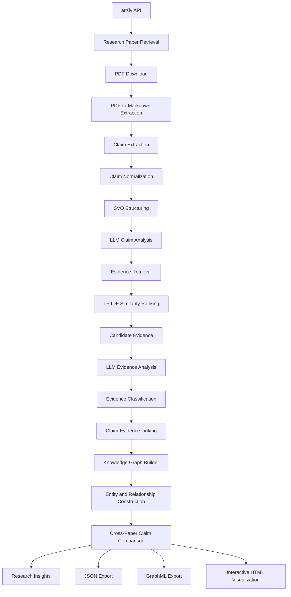
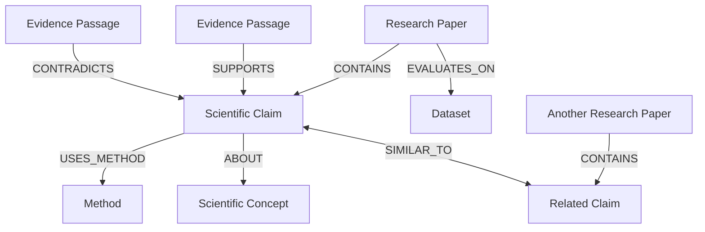

# Alethia
### An AI-Powered Scientific Literature Analysis and Knowledge Graph System

**Alethia** is an independent AI research engineering project that explores how scientific literature can be transformed into structured, interconnected knowledge.

It combines Natural Language Processing (NLP), Large Language Models (LLMs), information retrieval, evidence analysis, and knowledge graph construction to extract scientific claims from research papers, identify relevant evidence, evaluate claim-evidence relationships, and organize research information into an interconnected knowledge representation.

The central idea behind Alethia is simple:

**Scientific knowledge should not remain trapped inside individual research papers. It should be connected, traceable, and explorable.**

---

## Table of Contents

- [The Problem](#the-problem)
- [What Alethia Does](#what-alethia-does)
- [System Architecture](#system-architecture)
- [Core Components](#core-components)
- [Scientific Knowledge Graph](#scientific-knowledge-graph)
- [Interactive Graph Visualization](#interactive-graph-visualization)
- [Technology Stack](#technology-stack)
- [Project Structure](#project-structure)
- [Installation and Configuration](#installation-and-configuration)
- [Project Status](#project-status)
- [Limitations and Research Considerations](#limitations-and-research-considerations)
- [Future Development](#future-development)
- [Author](#author)

---

## The Problem

Scientific research is distributed across an enormous and continuously expanding collection of publications.

A finding in one paper may support, contradict, extend, or provide context for findings in another. However, identifying these relationships manually requires researchers to repeatedly search, read, compare, and interpret individual publications.

Traditional document-based research workflows do not inherently provide a unified representation of:

- What scientific claims have been made?
- What evidence supports or contradicts those claims?
- Which research papers discuss similar findings?
- What methodologies and algorithms are being used?
- Which scientific concepts connect different publications?
- Where might potentially conflicting findings exist?

Alethia explores an automated approach to this problem by transforming research documents into structured scientific information and connecting that information through a knowledge graph.

---

## What Alethia Does

Alethia implements a multi-stage scientific literature analysis pipeline.

| Component | Responsibility |
|---|---|
| Paper Retrieval | Retrieves scientific publications from arXiv |
| PDF Processing | Extracts structured text from research papers |
| Claim Extraction | Identifies potentially meaningful scientific claims |
| Claim Normalization | Structures claims and extracts subject-predicate-object information |
| AI Claim Analysis | Normalizes and classifies extracted scientific claims |
| Evidence Retrieval | Finds relevant passages associated with scientific claims |
| Evidence Analysis | Evaluates the relationship between claims and retrieved passages |
| Claim-Evidence Linking | Associates analyzed evidence with corresponding claims |
| Knowledge Graph Construction | Converts research information into interconnected graph entities |
| Cross-Paper Comparison | Identifies potentially related claims across different publications |
| Research Insights | Extracts structured observations from the constructed graph |
| Visualization | Generates an interactive representation of the knowledge graph |

---

## System Architecture

Alethia follows a modular processing architecture.



The architecture separates linguistic processing, AI-assisted interpretation, evidence retrieval, and graph construction into distinct stages.

This separation allows individual components to be developed and improved without treating the entire system as one monolithic model.

---

## Core Components

### 1. Scientific Paper Retrieval and PDF Processing

**Files:**
- `backend/app/search/arxiv/download.py`
- `backend/app/extraction/extractor.py`

Alethia retrieves research publications through the arXiv API.

The retrieval module:

1. Accepts a research topic from the user.
2. Constructs an arXiv search query.
3. Retrieves publication metadata and PDF links.
4. Downloads the corresponding research papers.
5. Processes the downloaded PDFs.

For document processing, Alethia uses PyMuPDF4LLM to convert scientific PDFs into Markdown-like text representations.

The extraction module organizes document content around detected section headings, preserving a structured representation of the research paper for subsequent analysis.

### 2. Scientific Claim Extraction

**File:** `backend/app/extraction/claim_extractor.py`

The claim extraction component identifies statements that potentially express scientific findings, conclusions, propositions, hypotheses, and other research-related assertions.

It processes extracted document text and applies linguistic and pattern-based analysis to identify candidate claims.

The objective is to distinguish potentially meaningful scientific statements from the surrounding document content.

### 3. Claim Normalization and SVO Structuring

**File:** `backend/app/extraction/claim_normalizer.py`

Extracted claims may contain inconsistent wording, complex sentence structures, and unnecessary linguistic variations.

Alethia processes these statements using spaCy and the `en_core_web_lg` language model.

One of the important techniques implemented in this component is Subject-Verb-Object (SVO) extraction.

For a candidate scientific statement, the system identifies:

- **Subject:** The entity performing or associated with an action.
- **Verb:** The central action or relationship.
- **Object:** The entity or concept affected by the relationship.

The component also includes a verb-strength calculation based on linguistic patterns.

This structured representation provides additional information for downstream claim analysis and graph construction.

### 4. AI-Assisted Claim Analysis

**File:** `backend/app/extraction/ai_claim_analyzer.py`

Alethia uses an LLM through OpenRouter to analyze and normalize extracted scientific claims.

The model is instructed to return structured JSON containing:

- Normalized scientific claim
- Subject
- Relation
- Object
- Claim type
- Evidence requirement
- Confidence score

The claim classifier recognizes categories such as:

- Method
- Result
- Comparison
- Finding
- Hypothesis
- Theoretical
- Dataset
- Limitation
- Conclusion
- Other

The resulting structured information is used by subsequent stages of the analysis pipeline.

### 5. Evidence Retrieval

**File:** `backend/app/extraction/evidence_retriever.py`

After extracting and analyzing scientific claims, Alethia searches for potentially relevant evidence within the research papers.

The retrieval component uses:

- NLTK sentence tokenization
- TF-IDF vectorization
- Cosine similarity

The process works by:

1. Splitting extracted research text into individual sentences.
2. Representing the claim and candidate sentences using TF-IDF.
3. Calculating cosine similarity between the claim and candidate sentences.
4. Filtering exact and near-identical matches.
5. Ranking the remaining candidates by similarity.
6. Returning the highest-ranked evidence candidates.

The retrieval component currently supports configurable top-k candidate selection.

Importantly, similarity is used to identify potentially relevant passages, not to establish that a passage actually supports a scientific claim.

### 6. AI-Assisted Evidence Analysis

**File:** `backend/app/extraction/ai_evidence_analyzer.py`

This component evaluates retrieved passages against their corresponding scientific claims.

Unlike similarity-based retrieval, evidence analysis focuses on the semantic relationship between a claim and each candidate passage.

Alethia uses Ollama for local LLM inference, with `llama3.2` as the default configured model.

Each candidate passage is evaluated independently.

The classifier recognizes four possible relationships:

| Relationship | Meaning |
|---|---|
| `supports` | The passage provides information supporting the claim |
| `contradicts` | The passage provides information conflicting with the claim |
| `insufficient` | The passage is related but does not provide enough information |
| `irrelevant` | The passage does not provide useful evidence for evaluating the claim |

Each analyzed passage receives:

- Original evidence sentence
- Similarity score
- Relationship classification
- Evidence strength
- Explanation of the classification

Evidence strength is represented on a scale from 0.0 to 1.0.

The module also determines:

- Best evidence
- Overall claim-evidence relationship
- Overall evidence strength

The analysis is returned in structured JSON and validated before being saved.

**An important distinction:** Evidence strength represents the strength of the relationship between a passage and a claim. It does not establish that the scientific claim itself is objectively true.

### 7. Claim-Evidence Linking

**File:** `backend/app/extraction/claim_evidence_linker.py`

The linking component processes analyzed evidence and applies filtering criteria before producing the final evidence collection.

The current implementation retains passages satisfying the following conditions:

- Similarity score of at least 0.1.
- Relationship classified as `supports`.
- Evidence strength of at least 0.3.

The selected evidence is stored with its original sentence, similarity, relationship, strength, and reasoning.

This produces a filtered evidence representation for downstream processing.

### 8. Knowledge Graph Construction

**File:** `backend/app/extraction/knowledge_graph_builder.py`

The knowledge graph builder is one of Alethia's central components.

It transforms structured research information into a provenance-preserving directed multigraph using NetworkX.

Rather than representing a paper as a single isolated document, the builder creates individual graph entities and connects them through typed relationships.

The implementation includes:

**Input processing**
- Loads matched and analyzed evidence data.
- Supports the flattened final evidence representation.
- Optionally incorporates research paper metadata.
- Normalizes different JSON input structures.

**Node construction**
- Creates paper nodes.
- Creates scientific claim nodes.
- Creates evidence nodes.
- Identifies methodologies and algorithms.
- Recognizes scientific concepts.
- Creates model and dataset entities.
- Preserves extracted subjects and objects.
- Represents extracted hypotheses.

**Relationship construction**

The graph uses typed, directed relationships to represent connections between its entities.

Examples include:

- `CONTAINS`
- `SUPPORTS`
- `CONTRADICTS`
- `INSUFFICIENT`
- `IRRELEVANT`
- `ABOUT`
- `DISCUSSES`
- `USES_METHOD`
- `USES_ALGORITHM`
- `EVALUATES_ON`
- `INTRODUCES`
- `EXPRESSES_HYPOTHESIS`
- `SIMILAR_TO`

The graph builder also preserves evidence attributes such as similarity, strength, reasoning, source paper, and page information when available.

**Deterministic identification and deduplication**

Alethia generates stable entity identifiers using SHA-256-based hashing.

This allows graph entities to retain consistent identifiers across repeated builds when their underlying identity remains unchanged.

Evidence is deduplicated within its source paper rather than globally, preserving the provenance of identical passages appearing in different publications.

### 9. Cross-Paper Claim Comparison

The knowledge graph builder also implements cross-paper claim comparison.

This component explores relationships between scientific claims originating from different research papers.

The process uses TF-IDF and cosine similarity to identify potentially related claims.

Claims from the same source paper are excluded from this cross-paper comparison.

Similarity identifies candidate relationships; it does not establish scientific agreement or contradiction.

An optional LLM-based comparison stage can further classify selected claim pairs using Ollama.

Its possible classifications include:

- Supporting relationships
- Contradicting relationships
- Extensions
- Similar findings
- Shared research problems
- Similar methodologies
- Uncertain relationships

The optional comparison stage considers contextual differences, including methods, datasets, populations, metrics, and experimental conditions.

Potential support and contradiction relationships are explicitly marked as AI-suggested and unverified.

The cross-paper LLM stage is disabled by default and can be enabled through environment configuration.

---

## Scientific Knowledge Graph

The knowledge graph is designed to represent scientific information as interconnected entities rather than isolated text records.

### Graph Entity Types

The current graph builder supports the following entity categories:

| Entity | Description |
|---|---|
| Paper | A scientific publication |
| Claim | An extracted and normalized scientific statement |
| Evidence | A passage retrieved from a research paper |
| Method | A research methodology or technique |
| Algorithm | An algorithm identified in research information |
| Model | A machine learning model |
| Dataset | A dataset or benchmark |
| Concept | A recognized scientific concept |
| Entity | An extracted subject or object |
| Hypothesis | A hypothesis identified in a scientific claim |

### Relationship Model

The relationships between entities preserve the structure and context of the research information.

For example:



The graph is constructed as a directed multigraph, allowing multiple typed relationships between the same entities.

### Cross-Paper Knowledge

An important objective of the graph is to make connections between publications easier to explore.

For example, two papers may:

- Investigate similar scientific problems.
- Use related methodologies.
- Discuss overlapping concepts.
- Present potentially similar findings.
- Contain claims that may warrant further comparison.

The graph provides a structured representation of these relationships while retaining their source information.

---

## Interactive Graph Visualization

Alethia generates an interactive HTML visualization of its knowledge graph.

**Generated artifact:**

`arXiv papers/knowledge_graph/alethia_knowledge_graph.html`

The viewer is built around vis-network and provides an interactive interface for exploring the graph.

Its functionality includes:

- Interactive graph navigation.
- Search across graph entities.
- Entity-type filters.
- Node selection.
- Detailed entity information.
- Evidence and claim inspection.
- Relationship exploration.
- Navigation between connected entities.
- Zoom controls.
- Graph fitting and physics controls.
- Connection highlighting.

Selecting a node opens a details panel containing its available attributes and connected entities.

The visualization also provides access to source-paper relationships, allowing users to navigate between scientific claims and their research context.

The HTML viewer loads vis-network and web fonts from external CDNs, so an internet connection is required for those resources.

### Graph Export Formats

Alethia produces three principal graph representations:

| Format | Purpose |
|---|---|
| HTML | Interactive graph exploration |
| JSON | Structured graph nodes, edges, and attributes |
| GraphML | Graph interoperability and further analysis |

Additional outputs include:

- `research_insights.json`
- `build_report.json`

---

## Research Insights

The knowledge graph builder generates structured observations from the constructed graph.

Current insight categories include:

**Repeated Methods**

Identifies methodologies appearing across multiple research papers.

**Similar Cross-Paper Claims**

Records claims identified as potentially related through cross-paper similarity analysis.

**Potential Contradictions**

Records AI-suggested potential contradictions between claims, preserving their explanations and confidence information.

The implementation deliberately avoids presenting unverified AI-generated comparisons as established scientific conclusions.

Research gaps, AI-generated hypotheses, and suggested experiments are reserved for future evidence-grounded development.

---

## Technology Stack

| Category | Technologies |
|---|---|
| Programming Language | Python |
| Scientific Paper Retrieval | arXiv API |
| PDF Processing | PyMuPDF4LLM |
| Natural Language Processing | spaCy, NLTK |
| Linguistic Analysis | SVO Extraction, Dependency Parsing |
| Claim Analysis | OpenRouter, LLMs |
| Evidence Analysis | Ollama, Llama 3.2 |
| Information Retrieval | TF-IDF |
| Similarity Measurement | Cosine Similarity |
| Graph Construction | NetworkX |
| Graph Interoperability | GraphML |
| Data Representation | JSON |
| Interactive Visualization | HTML, CSS, JavaScript, vis-network |

---

## Project Structure

```text
Alethia/
│
├── backend/
│   └── app/
│       ├── extraction/
│       │   ├── ai_claim_analyzer.py
│       │   ├── ai_evidence_analyzer.py
│       │   ├── claim_evidence_linker.py
│       │   ├── claim_extractor.py
│       │   ├── claim_normalizer.py
│       │   ├── evidence_retriever.py
│       │   ├── extractor.py
│       │   └── knowledge_graph_builder.py
│       │
│       └── search/
│           └── arxiv/
│               └── download.py
│
├── arXiv papers/
│   ├── arxiv_papers_full.json
│   ├── final_evidences.json
│   ├── paper0.pdf
│   ├── paper1.pdf
│   │
│   └── knowledge_graph/
│       ├── alethia_knowledge_graph.graphml
│       ├── alethia_knowledge_graph.html
│       ├── alethia_knowledge_graph.json
│       ├── build_report.json
│       └── research_insights.json
│
├── architecture/
├── datasets/
├── docs/
├── experiments/
├── frontend/
├── notebooks/
├── research/
│
├── .gitignore
├── LICENSE
├── README.md
└── temp.py
```

---

## Installation and Configuration

### Prerequisites

- Python 3.10 or later.
- Git.
- An OpenRouter API key for AI-assisted claim analysis.
- Ollama installed locally for evidence analysis.
- Sufficient memory and computational resources for local LLM inference.

### 1. Clone the Repository

```bash
git clone https://github.com/iamHammadA/Alethia.git
cd Alethia
```

### 2. Create a Virtual Environment

```bash
python -m venv venv
```

Activate it on Windows:

```powershell
venv\Scripts\activate
```

Activate it on Linux:

```bash
source venv/bin/activate
```

### 3. Install Dependencies

```bash
pip install requests beautifulsoup4 pymupdf4llm nltk spacy scikit-learn networkx ollama python-dotenv google-genai
```

Install the spaCy language model:

```bash
python -m spacy download en_core_web_lg
```

### 4. Configure OpenRouter

Create a `.env` file in the project root or configure the appropriate environment variables.

```env
OPENROUTER_API_KEY=your_openrouter_api_key
```

Never commit API keys or other credentials to version control.

### 5. Configure Ollama

Install Ollama and download the default evidence-analysis model:

```bash
ollama pull llama3.2
```

Ensure the Ollama service is running before executing local inference stages.

### 6. Configure Optional Cross-Paper LLM Analysis

The knowledge graph builder supports optional LLM-based cross-paper claim comparison.

Set the following environment variables to enable it:

```env
ALETHIA_CROSS_PAPER_LLM=1
OLLAMA_CROSS_PAPER_MODEL=llama3.2
```

The optional cross-paper comparison can also be configured using:

```env
ALETHIA_CLAIM_SIMILARITY_THRESHOLD=0.35
ALETHIA_MAX_LLM_PAIRS=40
ALETHIA_MAX_HTML_NODES=2500
```

These settings control candidate similarity, the maximum number of LLM comparisons, and the HTML visualization node limit.

**Note:** Alethia's processing modules currently operate as separate pipeline components. A unified command-line orchestration and installation workflow is still a development area.

---

## Project Status

**Current Release: Version 1 — Core Literature Analysis and Knowledge Graph Pipeline**

Version 1 establishes the foundational components of Alethia.

Implemented capabilities include:

- arXiv research paper retrieval.
- Scientific PDF processing.
- NLP-based claim extraction.
- SVO-based claim structuring.
- AI-assisted claim normalization.
- TF-IDF-based evidence retrieval.
- LLM-based evidence classification.
- Evidence strength and relationship scoring.
- Claim-evidence linking.
- Provenance-preserving knowledge graph construction.
- Scientific entity and relationship representation.
- Cross-paper claim similarity analysis.
- Optional LLM-based cross-paper comparison.
- Research insight generation.
- JSON and GraphML graph exports.
- Interactive HTML graph visualization.

The project is currently a research engineering prototype. Its architecture and core processing components have been implemented, but systematic evaluation and broader validation remain necessary.

---

## Limitations and Research Considerations

Alethia is intended to assist scientific literature exploration, not replace expert scientific judgment.

Some important considerations include:

1. **LLM Reliability:** AI-generated claim and evidence classifications may contain errors and require independent validation.

2. **Similarity vs. Evidence:** Textual similarity identifies potentially relevant passages but does not establish scientific support.

3. **Evidence Coverage:** Retrieved evidence depends on the available paper text, claim representation, and retrieval settings.

4. **Cross-Paper Comparisons:** Similarity-based relationships are candidate connections, not proof of scientific agreement.

5. **Potential Contradictions:** LLM-suggested contradictions are explicitly marked as unverified and should not be treated as established scientific conflicts.

6. **Scale:** The current implementation requires further optimization and evaluation for larger research collections.

7. **Research Discovery:** Automated research-gap identification and evidence-grounded experiment generation are not yet implemented.

---

## Future Development

Potential research and engineering directions include:

- More robust scientific claim extraction.
- Improved semantic evidence retrieval.
- Better claim normalization and entity resolution.
- More sophisticated cross-paper relationship identification.
- Evidence-grounded contradiction analysis.
- Improved provenance and citation tracking.
- Research-gap identification based on connected evidence.
- Evidence-grounded hypothesis generation.
- Suggested experiment generation.
- Scalable graph construction and querying.
- Systematic evaluation against manually annotated scientific literature.

---

## Author

**Hammad A.**

Independent AI Research & Development

GitHub: [@iamHammadA](https://github.com/iamHammadA)

Project Repository: [github.com/iamHammadA/Alethia](https://github.com/iamHammadA/Alethia)

---

## License

See the [LICENSE](LICENSE) file for licensing information.

---

<p align="center">
  <strong>Alethia</strong><br>
  Connecting scientific claims, evidence, and knowledge.
</p>
