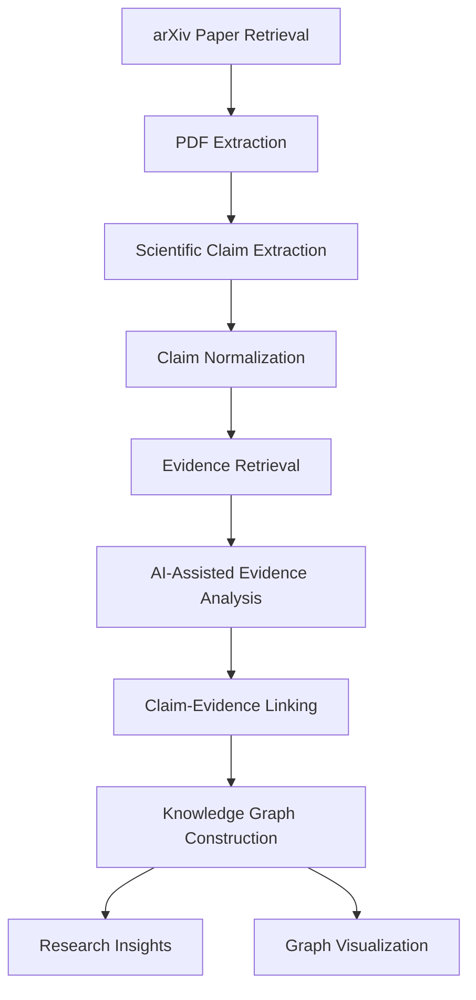

# Alethia — AI-Powered Scientific Literature Analysis

**Alethia** is an AI-powered scientific literature analysis system designed to transform research papers into structured, interconnected knowledge.

It analyzes scientific publications, extracts claims and supporting evidence, identifies relationships between findings, and constructs a knowledge graph that makes scientific information easier to explore and understand.

Rather than treating research papers as isolated documents, Alethia aims to connect their underlying scientific ideas.

---

## Overview

Scientific literature is growing rapidly. Understanding the relationships between claims, evidence, methodologies, and findings across multiple research papers can be a time-consuming process.

Alethia addresses this challenge through an automated literature analysis pipeline that processes research papers and organizes their information into a structured knowledge representation.

The system combines natural language processing, AI-assisted analysis, evidence retrieval, and knowledge graph construction to build an interconnected representation of scientific research.

## Key Features

- **Scientific Paper Retrieval:** Retrieves research papers from arXiv.
- **PDF Processing:** Extracts structured text from scientific publications.
- **Claim Extraction:** Identifies meaningful scientific claims from research text.
- **Claim Normalization:** Processes extracted claims into more consistent representations.
- **AI-Assisted Analysis:** Analyzes scientific statements and their relationships using language models.
- **Evidence Retrieval:** Retrieves relevant passages from research papers for claim analysis.
- **Evidence Classification:** Evaluates whether retrieved passages support, contradict, or provide insufficient or irrelevant evidence for a claim.
- **Claim-Evidence Linking:** Connects scientific claims with their corresponding evidence.
- **Knowledge Graph Construction:** Represents claims, evidence, papers, and their relationships in an interconnected graph.
- **Research Insights:** Generates structured insights from the constructed knowledge graph.
- **Graph Visualization:** Exports the knowledge graph into interactive HTML and GraphML formats.

## Architecture and Workflow

Alethia follows a multi-stage processing pipeline.



### 1. Paper Retrieval

Research papers are retrieved from arXiv and organized for subsequent processing.

### 2. PDF Extraction

Scientific documents are processed to extract their textual content for analysis.

### 3. Claim Extraction

The extracted text is analyzed to identify scientific claims and meaningful statements.

The system uses NLP techniques, including spaCy, to support linguistic processing and claim extraction.

### 4. Claim Normalization

Extracted claims are processed into more consistent representations to facilitate comparison and relationship analysis.

### 5. Evidence Retrieval

Relevant passages are retrieved from research papers to identify potential evidence associated with extracted claims.

### 6. AI-Assisted Evidence Analysis

Retrieved passages are evaluated against scientific claims.

The analysis classifies relationships into:

- Supports
- Contradicts
- Insufficient
- Irrelevant

Evidence is also assigned similarity and strength scores to help assess its relevance.

### 7. Claim-Evidence Linking

The analyzed evidence is associated with its corresponding claims, creating structured relationships between scientific statements and their supporting or contradicting passages.

### 8. Knowledge Graph Construction

The processed information is transformed into a knowledge graph.

The graph represents interconnected research information, including scientific claims, evidence, papers, and their relationships.

### 9. Research Insights and Visualization

The resulting knowledge graph can be exported into multiple formats:

- **HTML:** Interactive graph visualization.
- **GraphML:** Graph representation for compatible graph analysis tools.
- **JSON:** Structured knowledge graph data.

The system also generates structured research insights from the constructed graph.

---

## Technology Stack

| Component | Technology |
|---|---|
| Programming Language | Python |
| Natural Language Processing | spaCy |
| PDF Processing | PyMuPDF4LLM |
| AI-Assisted Analysis | Large Language Models |
| Model Access | OpenRouter |
| Local Inference | Ollama |
| Data Representation | JSON |
| Graph Export | GraphML |
| Visualization | Interactive HTML |

---

## Project Structure

```text
Alethia/
│
├── backend/
│   └── app/
│       ├── extraction/
│       │   ├── ai_claim_analyzer.py
│       │   ├── ai_evidence_analyzer.py
│       │   ├── claim_evidence_linker.py
│       │   ├── claim_extractor.py
│       │   ├── claim_normalizer.py
│       │   ├── evidence_retriever.py
│       │   ├── extractor.py
│       │   └── knowledge_graph_builder.py
│       │
│       └── search/
│           └── arxiv/
│               └── download.py
│
├── arXiv papers/
│   ├── arxiv_papers_full.json
│   ├── final_evidences.json
│   └── knowledge_graph/
│       ├── alethia_knowledge_graph.json
│       ├── alethia_knowledge_graph.graphml
│       ├── alethia_knowledge_graph.html
│       ├── build_report.json
│       └── research_insights.json
│
├── architecture/
├── datasets/
├── docs/
├── experiments/
├── frontend/
├── notebooks/
├── research/
│
├── LICENSE
└── README.md
```

*The structure above highlights the main components and selected generated artifacts. Additional files and modules are present in the repository.*

---

## Knowledge Graph

One of Alethia's central components is its scientific knowledge graph.

Instead of keeping extracted information as disconnected text, the graph organizes research information into connected entities and relationships.

It provides a structured representation of:

- Scientific claims
- Research papers
- Evidence passages
- Supporting relationships
- Contradicting relationships
- Connections between research findings

The graph is exported in JSON and GraphML formats, with an interactive HTML visualization.

---

## Project Status

**Version 1 — Initial Knowledge Graph Pipeline**

The first version establishes the core literature-analysis workflow, from paper retrieval and claim extraction to evidence analysis and knowledge graph construction.

Current implementation includes:

- Scientific paper retrieval and processing.
- AI-assisted claim and evidence analysis.
- Claim-evidence relationship construction.
- Knowledge graph generation.
- Structured research insights.
- Interactive HTML graph visualization.
- JSON and GraphML exports.

Alethia is an ongoing research engineering project. Its current implementation is a prototype, and further development, evaluation, and validation are needed to establish its reliability across larger and more diverse scientific literature collections.

---

## Future Development

Potential directions for future development include:

- Expanding cross-paper claim relationship analysis.
- Improving evidence retrieval and relevance scoring.
- Strengthening contradiction identification and validation.
- Improving knowledge graph exploration and visualization.
- Evaluating extraction and evidence-classification accuracy.
- Scaling analysis across larger scientific literature collections.

---

## Author

**Hammad A.**

AI Engineer | Independent AI Research & Development

GitHub: [@iamHammadA](https://github.com/iamHammadA)

---

## License

See the [LICENSE](LICENSE) file for licensing information.

---

*Alethia — Connecting scientific claims, evidence, and knowledge.*
