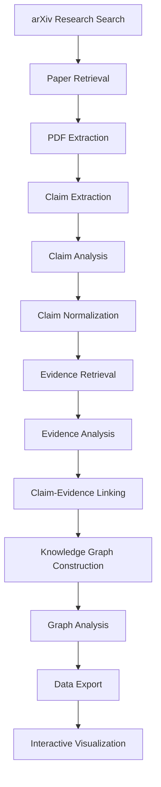
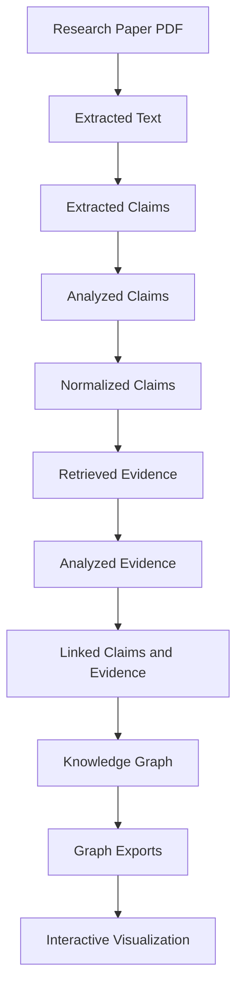

# Alethia — System Architecture

## 1. Overview

Alethia is an AI-powered scientific literature analysis system designed to transform research papers into structured, interconnected knowledge.

Instead of treating scientific papers as isolated documents, Alethia extracts research claims, identifies supporting evidence, recognizes important scientific entities, and connects these elements through a knowledge graph.

The system combines traditional Natural Language Processing (NLP), information retrieval, Large Language Models (LLMs), and graph-based knowledge representation.

Its primary objective is to make scientific literature easier to explore, compare, and understand.

---

## 2. High-Level Architecture

Alethia follows a modular processing architecture consisting of several interconnected stages.

Each stage produces structured information that is consumed by subsequent components.

The architecture is modular, allowing individual stages to be developed, tested, and improved independently.

---

## 3. Core Components

### 3.1 Research Paper Retrieval

**Location:** `backend/app/search/arxiv/`

Alethia retrieves scientific research papers using the arXiv API.

The retrieval component is responsible for:

- Searching for relevant research papers.
- Retrieving paper metadata.
- Identifying paper titles and identifiers.
- Obtaining downloadable PDF documents.
- Preparing retrieved papers for downstream processing.

The retrieved documents become the input to the extraction pipeline.

### 3.2 PDF Extraction

**Location:** `backend/app/extraction/extractor.py`

Alethia uses PyMuPDF4LLM to extract content from research papers.

The extraction process converts PDF documents into Markdown-oriented text suitable for further processing.

This stage aims to preserve the document's textual structure while making its contents accessible to NLP components.

### 3.3 Claim Extraction

**Location:** `backend/app/extraction/claim_extractor.py`

The claim extraction component identifies potentially meaningful scientific statements from research papers.

It uses NLP techniques, including spaCy and NLTK sentence tokenization, to process the extracted text.

The objective is to identify statements that express scientific findings, assertions, or relationships.

Extracted claims provide the foundation for subsequent analysis.

### 3.4 AI-Based Claim Analysis

**Location:** `backend/app/extraction/ai_claim_analyzer.py`

The claim analyzer uses an LLM through OpenRouter to examine extracted scientific statements.

Its responsibilities include identifying structured information such as:

- Subject
- Relation
- Object
- Claim type
- Evidence requirements
- Confidence
- Normalized claim representation

This transforms unstructured scientific statements into more consistent representations.

### 3.5 Claim Normalization

**Location:** `backend/app/extraction/claim_normalizer.py`

Scientific papers frequently express similar concepts using different terminology and sentence structures.

Claim normalization attempts to reduce this variation.

It produces more standardized claim representations, making claims easier to compare and connect across research papers.

### 3.6 Evidence Retrieval

**Location:** `backend/app/extraction/evidence_retriever.py`

After claims have been extracted and analyzed, Alethia searches for relevant passages within the source material.

The retrieval component uses:

- TF-IDF vectorization
- Cosine similarity
- Top-k candidate selection

For each claim, the system identifies potentially relevant passages that may provide supporting or conflicting evidence.

Similarity scores are used to rank candidate passages.

### 3.7 AI-Based Evidence Analysis

**Location:** `backend/app/extraction/ai_evidence_analyzer.py`

Retrieved passages are examined using a locally hosted LLM through Ollama.

The analyzer evaluates the relationship between a scientific claim and its candidate evidence.

The possible relationship classifications are:

| Relationship | Meaning |
|---|---|
| Supports | The passage provides support for the claim. |
| Contradicts | The passage conflicts with the claim. |
| Insufficient | The passage does not provide enough information to determine the relationship. |
| Irrelevant | The passage is not meaningfully related to the claim. |

The analysis also produces:

- Similarity score
- Evidence strength
- Explanation of the relationship

These outputs provide a structured representation of the relationship between claims and their evidence.

### 3.8 Claim-Evidence Linking

**Location:** `backend/app/extraction/claim_evidence_linker.py`

This component connects analyzed evidence with its corresponding scientific claims.

It processes the evidence analysis results and applies filtering conditions.

The current implementation uses the following criteria for selecting supporting evidence:

- Similarity score greater than or equal to `0.1`.
- Relationship classified as `supports`.
- Evidence strength greater than or equal to `0.3`.

The resulting relationships are used during knowledge graph construction.

The filtering criteria are configurable through the implementation and may require further evaluation against larger research datasets.

---

## 4. Knowledge Graph Architecture

**Location:** `backend/app/extraction/knowledge_graph_builder.py`

The knowledge graph is the central knowledge representation layer of Alethia.

It transforms extracted research information into a structured graph in which nodes represent scientific entities and edges represent relationships between them.

Alethia uses NetworkX to construct a directed multigraph.

A directed multigraph allows multiple relationships to exist between the same pair of nodes while preserving relationship direction.

### 4.1 Node Types

The graph supports multiple categories of nodes.

| Node Type | Description |
|---|---|
| Paper | A scientific research paper. |
| Claim | An extracted scientific claim. |
| Evidence | A passage associated with a claim. |
| Method | A research methodology. |
| Algorithm | An algorithm discussed or used in research. |
| Model | A machine learning or scientific model. |
| Dataset | A dataset used or discussed in a paper. |
| Concept | A scientific concept. |
| Entity | An identified scientific entity. |
| Hypothesis | A research hypothesis. |

### 4.2 Relationship Types

The graph uses typed relationships to represent connections between nodes.

| Relationship | Description |
|---|---|
| CONTAINS | A paper contains a claim or other information. |
| SUPPORTS | Evidence supports a claim. |
| CONTRADICTS | Evidence contradicts a claim. |
| INSUFFICIENT | Evidence is insufficient to establish a relationship. |
| IRRELEVANT | Evidence is unrelated to a claim. |
| ABOUT | A paper or claim concerns a particular subject. |
| DISCUSSES | A paper discusses a scientific concept or entity. |
| USES_METHOD | A paper uses a research method. |
| USES_ALGORITHM | A paper uses an algorithm. |
| EVALUATES_ON | A model or method is evaluated on a dataset. |
| INTRODUCES | A paper introduces a particular contribution. |
| EXPRESSES_HYPOTHESIS | A paper or claim expresses a hypothesis. |
| SIMILAR_TO | Two graph elements have a similarity relationship. |

### 4.3 Graph Construction

The knowledge graph builder performs several operations:

1. Reads the structured research data produced by earlier pipeline stages.
2. Creates nodes for papers, claims, evidence, and scientific entities.
3. Establishes relationships between the nodes.
4. Preserves source information and provenance.
5. Uses deterministic SHA-256-based identifiers.
6. Handles evidence deduplication within individual papers.
7. Retains provenance information when evidence is reused.
8. Identifies potential cross-paper relationships.
9. Generates graph-level research insights and build information.

The graph is designed to preserve the connection between scientific findings and the research material from which they originated.

### 4.4 Cross-Paper Relationships

Alethia also examines similarities between information extracted from different research papers.

TF-IDF and cosine similarity are used to identify potentially related graph elements.

An optional LLM-based comparison component can further examine relationships such as:

- Supporting findings
- Contradictory findings
- Extensions of previous work
- Similar findings
- Shared research problems
- Methodological relationships
- Uncertain relationships

LLM-generated relationship suggestions are treated as unverified suggestions rather than established scientific conclusions.

---

## 5. Graph Export and Visualization

After graph construction, Alethia exports the resulting knowledge representation into multiple formats.

**Output directory:** `arXiv papers/knowledge_graph/`

### 5.1 Export Formats

| File | Purpose |
|---|---|
| `alethia_knowledge_graph.json` | Structured graph representation. |
| `alethia_knowledge_graph.graphml` | GraphML representation for external graph tools. |
| `alethia_knowledge_graph.html` | Interactive browser-based graph visualization. |
| `research_insights.json` | Generated graph-level research insights. |
| `build_report.json` | Information about the graph construction process. |

### 5.2 Interactive Visualization

The HTML visualization uses vis-network to display the knowledge graph.

Its implemented capabilities include:

- Interactive graph exploration.
- Node selection.
- Node detail inspection.
- Relationship exploration.
- Search functionality.
- Entity filtering.
- Graph navigation.
- Zoom controls.
- Graph fitting.
- Physics-based graph layout.

The visualization provides a way to explore connections between research papers, claims, evidence, and scientific entities.

---

## 6. Technology Stack

| Technology | Role |
|---|---|
| Python | Core implementation language. |
| arXiv API | Scientific paper retrieval. |
| PyMuPDF4LLM | PDF content extraction. |
| spaCy | Natural Language Processing. |
| NLTK | Sentence tokenization. |
| Scikit-learn | TF-IDF and cosine similarity. |
| OpenRouter | Access to hosted LLMs for claim analysis. |
| Ollama | Local LLM inference for evidence analysis. |
| NetworkX | Knowledge graph construction. |
| vis-network | Interactive graph visualization. |
| JSON | Intermediate data representation and export. |
| GraphML | Graph interchange format. |

---

## 7. Data Flow and Intermediate Representations

Alethia uses structured data between pipeline stages rather than relying exclusively on raw text.

The general data flow is:

Intermediate JSON representations make it possible to inspect the outputs of individual stages and reuse structured data during graph construction.

This separation also makes debugging and future component improvements easier.

---

## 8. Design Principles

Alethia's architecture follows several design principles.

### Modularity

Each major processing stage is implemented as a separate component.

This allows individual components to be modified without requiring a complete redesign of the system.

### Hybrid Intelligence

Alethia combines deterministic computational methods with LLM-based analysis.

Traditional NLP and similarity-based retrieval handle structured processing tasks, while LLMs assist with semantic interpretation.

### Local Processing

Evidence analysis can be performed using locally hosted models through Ollama.

This provides an alternative to relying entirely on remote inference services.

### Traceability

Relationships between claims and evidence retain information about their source material.

This helps users inspect the research context behind a graph relationship.

### Interoperability

The graph is exported into standard formats such as JSON and GraphML, allowing further processing with external tools.

### Extensibility

The architecture is designed to support future improvements, including more advanced scientific relationship analysis and research discovery capabilities.

---

## 9. Current Limitations

Alethia Version 1 establishes the core literature-analysis and knowledge-graph pipeline. It does not yet implement every possible research-discovery capability.

Current limitations include:

- Evidence quality depends on retrieval performance and LLM classification.
- Similarity scores do not independently establish scientific validity.
- LLM-generated relationships may require manual verification.
- Graph completeness depends on the information extracted from the source papers.
- The current system does not establish scientific truth or independently validate experimental results.
- Automated research-gap discovery and experiment generation are not implemented features of Version 1.
- The current visualization depends on external CDN resources for some frontend assets.

These limitations define areas for further development and evaluation.

---

## 10. Future Architectural Directions

Potential future extensions include:

- More advanced cross-paper claim comparison.
- Improved evidence retrieval and ranking.
- Stronger scientific entity resolution.
- More comprehensive provenance tracking.
- Automated research-gap identification.
- Hypothesis generation.
- Experiment recommendation.
- Larger-scale graph processing.
- Quantitative evaluation of extraction and evidence-classification performance.

These are proposed directions rather than claims about existing Version 1 functionality.

---

## 11. Version 1 Architecture Status

Alethia Version 1 brings together the core components required to process scientific papers, extract and analyze claims, retrieve and classify evidence, construct a scientific knowledge graph, and visualize the resulting relationships.

The architecture establishes a foundation for evolving Alethia from a scientific literature-processing pipeline into a more comprehensive research exploration system.

**Version:** 1.0  
**Project:** Alethia  
**Author:** Hammad A.
