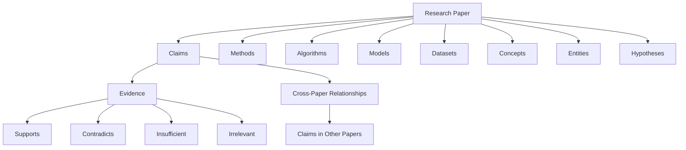

# Alethia — Scientific Knowledge Graph Ontology

## 1. Introduction

The Alethia ontology defines the conceptual structure of the scientific knowledge graph.

It establishes the categories of information represented in the graph, the relationships connecting them, and the semantic meaning of those relationships.

Alethia transforms scientific literature into structured knowledge by identifying claims, evidence, research methodologies, algorithms, models, datasets, concepts, entities, and hypotheses.

The ontology provides a common semantic structure for representing this information across multiple research papers.

Its primary purpose is to make scientific knowledge interconnected, traceable, and explorable.

---

## 2. Ontology Objectives

The ontology is designed to:

- Represent scientific papers as structured knowledge sources.
- Identify and represent scientific claims.
- Connect claims with their associated evidence.
- Distinguish supporting, contradictory, insufficient, and irrelevant evidence.
- Represent research methodologies, algorithms, and models.
- Identify datasets used or discussed in research.
- Represent scientific concepts and entities.
- Capture hypotheses expressed in scientific literature.
- Establish relationships between information extracted from different papers.
- Preserve the provenance of extracted information.

---

## 3. Core Ontology Structure

Alethia organizes scientific knowledge around several major conceptual categories.

This structure represents the conceptual organization of information within Alethia.

The actual graph is implemented as a directed multigraph, allowing multiple typed relationships between graph elements.

---

## 4. Ontology Classes

Ontology classes define the different categories of objects that can exist in the knowledge graph.

### 4.1 Paper

**Class:** `Paper`

Represents a scientific research paper retrieved from a research source.

**Attributes:**

- Paper identifier
- Title
- Authors, when available
- Abstract, when available
- Publication information, when available
- Source URL or arXiv identifier

**Purpose:**

Provides the research context and provenance for extracted scientific information.

### 4.2 Claim

**Class:** `Claim`

Represents a scientific statement, assertion, finding, or proposition extracted from a research paper.

**Attributes:**

- Claim identifier
- Original sentence
- Normalized claim
- Subject
- Relation
- Object
- Claim type
- Evidence requirement
- Confidence, when available

**Purpose:**

Represents individual scientific statements that can be analyzed, compared, and connected to evidence.

### 4.3 Evidence

**Class:** `Evidence`

Represents a passage or textual segment identified as potentially relevant to a scientific claim.

**Attributes:**

- Evidence identifier
- Original passage
- Source paper
- Similarity score
- Relationship classification
- Evidence strength
- Analysis explanation

**Purpose:**

Provides the textual basis for evaluating relationships between scientific claims and research material.

### 4.4 Method

**Class:** `Method`

Represents a research methodology, procedure, or approach discussed or employed in a scientific paper.

**Attributes:**

- Method identifier
- Method name
- Description, when available
- Source paper

**Purpose:**

Allows research methodologies to be identified and connected across scientific publications.

### 4.5 Algorithm

**Class:** `Algorithm`

Represents a computational or mathematical algorithm discussed or used in a research paper.

**Attributes:**

- Algorithm identifier
- Algorithm name
- Description, when available
- Source paper

**Purpose:**

Represents computational techniques and allows their use to be explored across papers.

### 4.6 Model

**Class:** `Model`

Represents a theoretical, computational, statistical, or machine learning model discussed or used in research.

**Attributes:**

- Model identifier
- Model name
- Model description, when available
- Source paper

**Purpose:**

Provides a representation of models used, introduced, or evaluated in scientific work.

### 4.7 Dataset

**Class:** `Dataset`

Represents a dataset used, introduced, or discussed in a scientific paper.

**Attributes:**

- Dataset identifier
- Dataset name
- Dataset description, when available
- Source paper

**Purpose:**

Connects research findings and models with the datasets involved in their evaluation or development.

### 4.8 Concept

**Class:** `Concept`

Represents an abstract scientific or technical idea discussed in research.

**Attributes:**

- Concept identifier
- Concept name
- Description, when available
- Source paper

**Purpose:**

Provides a way to connect papers discussing related scientific ideas.

### 4.9 Entity

**Class:** `Entity`

Represents an identified scientific entity that does not necessarily belong to another specialized category.

**Attributes:**

- Entity identifier
- Entity name
- Entity type, when available
- Description, when available
- Source paper

**Purpose:**

Provides a general representation for identifiable scientific entities.

### 4.10 Hypothesis

**Class:** `Hypothesis`

Represents a proposed explanation, assumption, or testable proposition expressed in scientific literature.

**Attributes:**

- Hypothesis identifier
- Hypothesis statement
- Description, when available
- Source paper

**Purpose:**

Makes hypotheses explicit graph elements that can be connected to research claims and supporting material.

---

## 5. Ontology Relationships

Relationships define how ontology classes connect to one another.

Alethia uses typed, directed edges to represent these connections.

### 5.1 CONTAINS

**Relationship:** `CONTAINS`

Connects a paper to information extracted from it.

**Example:**

`Paper → Claim`

A research paper contains an extracted scientific claim.

### 5.2 SUPPORTS

**Relationship:** `SUPPORTS`

Represents evidence that supports a scientific claim.

**Example:**

`Evidence → Claim`

A passage provides support for a particular claim.

### 5.3 CONTRADICTS

**Relationship:** `CONTRADICTS`

Represents evidence that conflicts with a scientific claim.

**Example:**

`Evidence → Claim`

A passage presents information that contradicts a particular claim.

### 5.4 INSUFFICIENT

**Relationship:** `INSUFFICIENT`

Represents evidence that does not provide enough information to establish whether a claim is supported or contradicted.

**Example:**

`Evidence → Claim`

A passage is related to a claim but does not establish its validity.

### 5.5 IRRELEVANT

**Relationship:** `IRRELEVANT`

Represents a retrieved passage that does not meaningfully relate to a claim.

**Example:**

`Evidence → Claim`

A candidate passage does not provide meaningful information about the claim.

### 5.6 ABOUT

**Relationship:** `ABOUT`

Connects a paper or claim to a subject, concept, or entity it concerns.

**Example:**

`Paper → Concept`

A research paper investigates a particular scientific concept.

### 5.7 DISCUSSES

**Relationship:** `DISCUSSES`

Represents that a paper discusses a scientific concept or entity.

**Example:**

`Paper → Entity`

A paper examines a particular scientific entity.

### 5.8 USES_METHOD

**Relationship:** `USES_METHOD`

Connects a research paper to a methodology used in its research.

**Example:**

`Paper → Method`

A paper employs a particular research methodology.

### 5.9 USES_ALGORITHM

**Relationship:** `USES_ALGORITHM`

Connects a research paper to an algorithm used in its implementation or experiments.

**Example:**

`Paper → Algorithm`

A paper uses a particular algorithm.

### 5.10 EVALUATES_ON

**Relationship:** `EVALUATES_ON`

Connects a model or method to a dataset on which it is evaluated.

**Example:**

`Model → Dataset`

A model is evaluated using a particular dataset.

### 5.11 INTRODUCES

**Relationship:** `INTRODUCES`

Represents the introduction of a new method, model, algorithm, concept, or contribution by a research paper.

**Example:**

`Paper → Model`

A research paper introduces a particular model.

### 5.12 EXPRESSES_HYPOTHESIS

**Relationship:** `EXPRESSES_HYPOTHESIS`

Connects a paper or claim to a hypothesis expressed within the research.

**Example:**

`Paper → Hypothesis`

A paper presents a particular research hypothesis.

### 5.13 SIMILAR_TO

**Relationship:** `SIMILAR_TO`

Represents a potential similarity between two graph elements.

**Example:**

`Claim → Claim`

Two claims from different research papers exhibit a degree of similarity.

This relationship may be identified through similarity-based comparison or optional LLM-assisted analysis.

A similarity relationship does not necessarily imply that the claims are scientifically equivalent.

---

## 6. Relationship Classification

Alethia distinguishes between different types of relationships rather than treating every connection as equivalent.

| Category | Relationship | Meaning |
|---|---|---|
| Evidence | SUPPORTS | Evidence supports a claim. |
| Evidence | CONTRADICTS | Evidence conflicts with a claim. |
| Evidence | INSUFFICIENT | Evidence is inconclusive. |
| Evidence | IRRELEVANT | Evidence is unrelated to a claim. |
| Structural | CONTAINS | A paper contains extracted information. |
| Semantic | ABOUT | An element concerns a subject. |
| Semantic | DISCUSSES | A paper discusses an entity or concept. |
| Research | USES_METHOD | A paper uses a methodology. |
| Research | USES_ALGORITHM | A paper uses an algorithm. |
| Research | EVALUATES_ON | A model or method is evaluated on a dataset. |
| Research | INTRODUCES | A paper introduces a contribution. |
| Research | EXPRESSES_HYPOTHESIS | A paper or claim expresses a hypothesis. |
| Similarity | SIMILAR_TO | Two elements are potentially similar. |

---

## 7. Provenance and Traceability

Provenance describes the origin of information represented in the knowledge graph.

Scientific knowledge should remain connected to the research material from which it was extracted.

Alethia preserves source information during graph construction.

### Provenance Principles

1. Extracted claims should retain their source paper.
2. Evidence should retain its original textual passage and source context.
3. Research methods, algorithms, models, and datasets should retain their associated paper information.
4. Relationships should preserve relevant information produced during analysis.
5. Deduplicated evidence should retain its provenance information.

### Purpose

Provenance enables users to trace graph information back to its research source.

It also makes it easier to inspect the context behind an extracted claim or relationship.

---

## 8. Graph Identity and Deduplication

Alethia uses deterministic SHA-256-based identifiers for graph elements.

These identifiers help maintain consistent references during graph construction.

Evidence deduplication is performed within individual papers while preserving provenance information.

The objective is to reduce unnecessary duplication without losing the relationship between extracted information and its source.

---

## 9. Cross-Paper Knowledge Relationships

A central purpose of Alethia is to connect information across multiple scientific papers.

The ontology allows claims, methods, algorithms, models, datasets, and concepts from different papers to be represented within the same graph.

Cross-paper comparisons can identify potential relationships such as:

- Similar findings
- Contradictory findings
- Extensions of previous work
- Shared research problems
- Related methodologies
- Similar scientific concepts

TF-IDF and cosine similarity are used to identify potentially related elements.

An optional LLM-based comparison component can provide further semantic classification.

These relationships should be treated as computationally generated suggestions rather than independently verified scientific conclusions.

---

## 10. Ontology Constraints and Semantic Rules

The following rules describe the intended meaning of graph elements and relationships.

1. A `Paper` represents a research document and acts as a source of extracted information.
2. A `Claim` represents a scientific statement rather than an entire research paper.
3. An `Evidence` node represents a textual passage, not an independently established scientific fact.
4. `SUPPORTS` and `CONTRADICTS` describe evaluated relationships between evidence and claims.
5. `INSUFFICIENT` and `IRRELEVANT` must remain distinct classifications.
6. Similarity does not independently establish scientific agreement.
7. A `Method`, `Algorithm`, or `Model` should retain its research context.
8. A `Dataset` should be associated with the paper or research activity in which it is discussed or used.
9. Provenance should be retained when graph elements are consolidated.
10. LLM-generated relationships should not automatically be treated as verified scientific conclusions.

These rules describe the intended semantics of the ontology. They do not necessarily represent formally enforced validation constraints in the current implementation.

---

## 11. Ontology Representation

The ontology is currently represented through the node types and relationship types implemented in Alethia's NetworkX knowledge graph.

The graph is exported into:

| File | Description |
|---|---|
| `alethia_knowledge_graph.json` | Structured knowledge graph representation. |
| `alethia_knowledge_graph.graphml` | GraphML representation for external graph tools. |
| `alethia_knowledge_graph.html` | Interactive graph visualization. |

These exports provide different ways to inspect and explore the ontology's instantiated knowledge.

---

## 12. Current Scope and Limitations

The ontology describes the conceptual structure used by Alethia Version 1.

It should not be interpreted as a complete formal scientific ontology or a universally accepted scientific knowledge standard.

Current limitations include:

- Entity identification may vary depending on extraction quality.
- Equivalent scientific entities may not always be recognized as identical.
- Relationship classification depends partly on LLM analysis.
- Similarity-based relationships do not establish scientific equivalence.
- Evidence relationships do not independently validate experimental results.
- Automated research-gap discovery is not an implemented Version 1 capability.
- Hypothesis generation and experiment recommendation remain potential future extensions.

The ontology can be expanded as Alethia's extraction, comparison, and graph capabilities evolve.

---

## 13. Future Ontology Extensions

Potential extensions include:

- More specialized scientific entity categories.
- Improved entity resolution and canonical naming.
- More detailed experimental design representations.
- Experimental results and measurements.
- Statistical significance and evaluation metrics.
- Research contributions and limitations.
- More detailed temporal relationships between research developments.
- Explicit representations of citations and research lineage.
- More advanced scientific contradiction modeling.

These extensions are proposed directions and are not claims about existing Version 1 functionality.

---

## 14. Conclusion

The Alethia ontology establishes a structured representation of scientific literature by defining the entities and relationships that form its knowledge graph.

By connecting research papers, claims, evidence, methodologies, algorithms, models, datasets, concepts, entities, and hypotheses, Alethia provides a foundation for exploring scientific knowledge beyond isolated documents.

The ontology is intended to evolve alongside the system, supporting increasingly detailed representations of scientific research and the relationships between discoveries.

**Project:** Alethia  
**Version:** 1.0  
**Author:** Hammad A.
